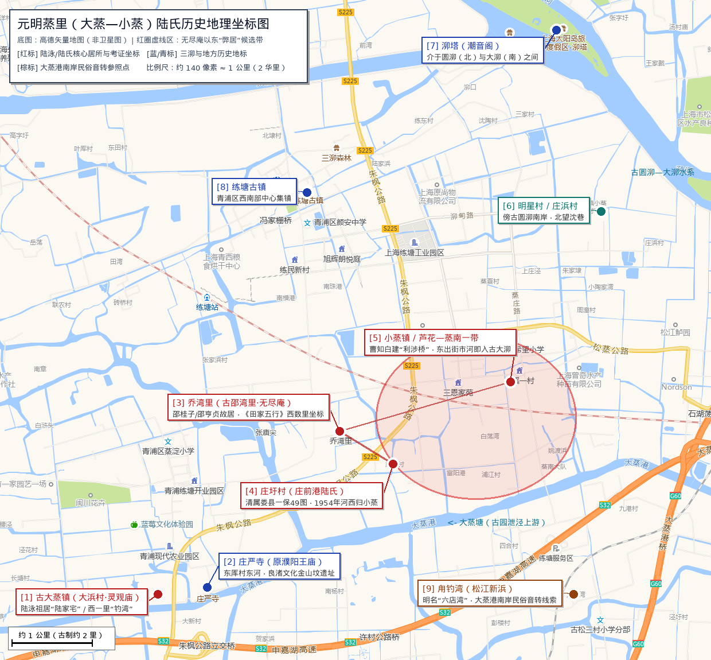
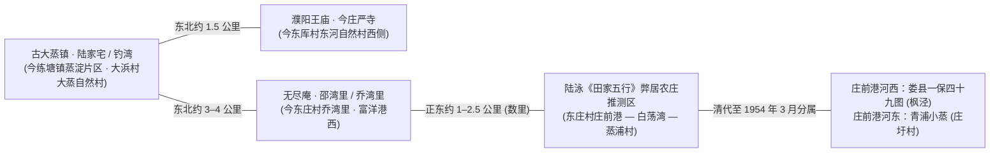
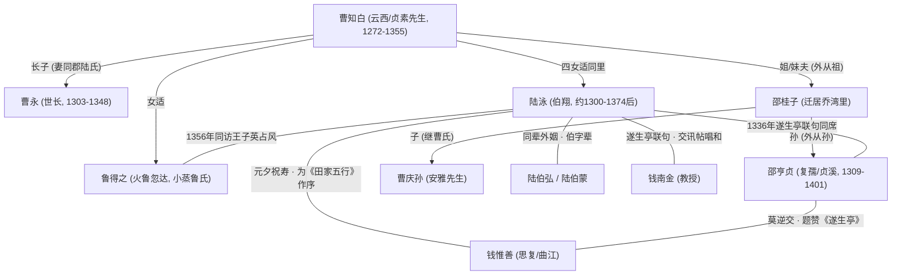

# 元末明初蒸里隐士陆泳（伯翔）生平与家族考略

本文依据《田家五行》、邵亨贞《蚁术诗选》、明·赵琦美编《赵氏铁网珊瑚·贞溪诸名胜词翰》、元末明初贡师泰《玩斋集·贞素先生墓志铭》、明·长谷真逸（学者考证即邵亨贞）《农田余话》以及清康熙《松江府志》等一手文献，梳理元末明初松江蒸里陆泳的生平、家族世系、姻亲交游与农学著述。

---

## 一、 基本信息

- **姓名与字号**：**陆泳**，字**伯翔**，晚年被同里亲友尊称为**翔翁**、**伯翔翁**。
- **生辰与大致生年**：生辰为**正月十五（元夕）**（《赵氏铁网珊瑚》邵亨贞诗注：“初度当元夕”）。明洪武三年（1370）冬，邵亨贞（生于 1309 年）在《编校遂生亭联句序》中称“惟伯翔及予亦皆年逾耳顺”，又在祝寿诗中称其为“翔翁亲长”，推测其生年约在 **1300—1306 年** 之间。
- **卒年与享年考**：史料未载具体卒年与享年，但可确定下限：洪武三年（1370）时已“年逾耳顺”（至少 63—70 岁）；约 1367—1374 年间仍“深衣雪鬓”赴金陵侯门授业。又邵亨贞元夕祝寿诗题称“遥致翔翁亲长弥高之颂”，结合其祖父享年 89 岁、岳父曹知白虚岁 84 岁、邵亨贞享年 93 岁等家族与同圈长寿特征，推测陆泳大概率享寿七十以上（甚至八十余岁），然确切终年不可考。
- **籍贯与居所**：松江府华亭县**大蒸**（今属上海青浦区练塘镇南部蒸淀、大蒸港一带）。贡师泰《贞素先生墓志铭》称其“同里陆泳”；清宣统二年（1910）《蒸里志略》载其故居在大蒸“陆家宅”，大蒸西一里有其垂钓处“钓湾”（今蒸淀南首**大浜村“大蒸”自然村**及以西一带，大蒸塘南岸）。另据《田家五行》卷中“弊居之西数里有一僧舍，名无尽庵”，结合康熙《松江府志》及《蒸里志略》“无尽庵在邵湾里（俗称轿湾，今地图作**乔湾里**）”，其撰写《田家五行》时的农居（“弊居”）则位于今乔湾里以东数里，即**东庄村（庄圩村 / 庄前港）至白荡湾、蒸浦村、大蒸港北岸**一带低洼水田区域（详见下文第七节考证）。
- **生平定位**：终身隐居未仕，博学能诗，在蒸里长期躬耕督农、采集吴语松江方言与农谚物候，撰成农学名著《田家五行》（原题《田家五行志》）；明初曾应聘赴金陵（南京）侯门授业讲学。

---

## 二、 家族成员与世系线索

| 成员 | 与陆泳关系 | 文献记载与关键信息 |
| :--- | :--- | :--- |
| **祖父（余大父）** | 祖父 | 《田家五行》卷下记其“晚年子孙蕃衍，家事从容，至老康健，寿享八十九岁”；中年曾于元旦在庭前沟口见“鼠拱”吉兆。陆泳自幼随其行寒食墓祭之礼。 |
| **家兄** | 兄长 | 《田家五行》卷上正月类提及“予幼时仅闻有末句，忽一日家兄云有上文一句，曰‘重午有风三伏热’”，说明陆泳上面尚有一位兄长，自幼同论农谚诗括。 |
| **陆泳（伯翔）** | 本人 | 自幼随祖父祭祖，成年后**自任家族主祭**（《田家五行》卷上：“予自有生以来，幼时祖父及自主祭此是”），在宗族中主持祭祀礼仪。 |
| **陆伯弘** | 同辈族亲（“伯”字辈） | 《蚁术诗选》遂生亭联句序将其与陆伯翔并列，称为“外姻”；邵亨贞有《早春次陆伯弘韵》《熏自闻上人禅房与陆伯弘暮坐偶成》，善诗好禅，同游曹园。 |
| **陆伯蒙** | 同辈族亲（“伯”字辈） | 《蚁术诗选》有《新春答陆伯蒙见寄之韵》，赞其“谈玄广坐风生席，乘兴孤舟雪满川”；《式古堂书画汇考》所录曹知白手书《曹云西交讯帖》亦提及“兹筑（托）伯蒙处，便谨附短书”，证实其确与曹知白、钱南金、陆伯翔同属小蒸亲友圈。 |
| **妻（曹氏）** | 妻子 | 元代名士、画坛巨擘**曹知白**（1272–1355，字又玄，号云西，私谥贞素先生）**第四女**（《玩斋集》：“女五人：长适上海瞿天祐，早卒，继室以季女；次适嘉定高巴延；次适常德路达鲁噶齐哈喇哈达，封大兴县君；次适同里陆泳”）。 |

---

## 三、 姻亲与核心交游网络（亲友人物谱）

通过与小蒸曹氏结亲，陆泳深度嵌入了元末江南顶级士绅与文化名流圈：

### 1. 岳家：小蒸曹氏直系与旁支

- **岳父·曹知白（1272–1355）**：字又玄，号云西，私谥贞素先生。十八世祖曹景修宋宣和间自温州迁华亭长谷之西，至曹知白已是第五代望族；妻李氏为宋观文殿大学士李曾伯曾孙女。至元三十一年（1294）曾随行开凿吴淞江，晚年在小蒸建“曹园”，与赵孟頫、黄公望、倪瓒、虞集、杨维桢等名流交好，举办“曹园雅集”。
- **内兄·曹南永（曹永，字世长）**：曹知白独子。《玩斋集》作“南永”，《蒸里志略》作“子永，字世长”，即《遂生亭联句》中的“世长”。以蒙古字学授瑞州学正，改柳州路马平县都博镇巡检，未任而卒；善正书（学钟繇）与行书（学二王），家藏《定武兰亭》善本，自号“兰亭生”。
- **妻侄·曹驺虞、曹于菟、曹幼彪、曹炳**：曹知白诸孙（长孙驺虞早世，于菟出面请贡师泰为祖父撰墓志铭）；明初**曹炳**曾重葺先人瀼东故地为“东园、西园”，又筑“一枝安”以馆避兵泖上的钱应庚。
- **岳家叔伯兄弟**：
  - **僧自闻（熏师）**：曹知白从弟，小蒸禅僧，遂生亭联句八人之一；陆伯弘常在其禅房暮坐论禅。
  - **曹庆孙（安雅翁）**与**曹宗儒（字元博）**：曹庆孙本姓邵，为邵桂子之子（邵亨贞亲伯/叔父），因继舅氏曹氏后而改姓曹，筑“安雅斋”（柯九思作记），至正年间曾访求小昆山二陆故址、请建“二俊祠”，并撰写曹知白行状。其子**曹宗儒**（字元博，洪武初任华亭教谕）即邵亨贞《遂生亭联句序》中所称保存原稿的“**元博弟**”。

### 2. 连襟：横跨江南巨族与色目高官

据《玩斋集·贞素先生墓志铭》及康熙《松江府志》，曹知白五女中四女嫁陆泳，其余诸婿包括：
- **鲁得之（火鲁忽达）**：西域康里人，元武宗朝尚书省右丞（平章冀国公）保八之子；元仁宗朝保八遇政变被诛，火鲁忽达幼时避乱流落江南，因安贫好学而入赘小蒸曹氏（《松江府志》载“弱冠为馆甥于小蒸曹氏”）。乙亥大都乡试中举，历任晋宁治中，至正五年（1345）任长兴州达鲁花赤（改监长兴州），以振兴文教、修葺学宫闻名；秩满仍居小蒸，后历漕运万户、浙东元帅、利用监大卿，亦善诗文（传世有《谒解州庙》等诗）。其子**鲁企贤**仕至吏部尚书，后裔以“鲁”为姓繁衍成“小蒸鲁氏”。
  - **重要交集**：《田家五行》卷上明载，**至正丙申（1356）正月十六落灯夜，陆泳曾与鲁得之同赴王子英处**，讨教东南风与水乡低田丰歉之占候（“至正丙申，此夕与鲁得之晚到□□□者王子英处，说晴而东南风……”）。这是两位曹氏女婿在元末文献中直接同框的珍贵实证。
- **瞿天祐**：上海望族（下沙瞿氏，与两浙都转运盐使瞿霆发同族），娶曹知白长女（早卒），后复继室以季女。
- **高巴延**（嘉定人）、**哈喇哈达**（常德路达鲁噶齐，妻封大兴县君）。

### 3. 同里外姻与诗文挚友

- **邵亨贞（1309–1401）**：字复孺，号贞溪、见独居士，严陵名士邵桂子之孙（《蒸里志略》订正邵桂子娶小蒸曹应符之女，因家小蒸**邵湾里**，俗称**轿湾**），与陶宗仪为莫逆交，子克颖（字伯宣）。其在《编校遂生亭联句序》中称陆伯翔、陆伯弘为“外姻”，在祝寿诗中尊称陆泳为“翔翁亲长”；又在《农田余话》（署名长谷真逸，学者考证即邵亨贞）中称“**故眷家伯翔陆先生尝著《田家五行志》若干卷，专述田家俗谈，为农家占候。一家之书，率多可验**”。
- **钱南金**：儒学教授（《式古堂书画汇考》曹知白行书《曹云西交讯帖》称“南金教授学士讲下”，信中并提及钱氏与“伯暘”〔疑即伯翔行书误识〕“联篇雅制”），《蚁术诗选》称其“授业茶院”并尊为“诸父”，亦小蒸/贞溪一带核心诗友，同参 1336 年遂生亭雅集。《蚁术词选》中存有《浪淘沙·钱南金疾作代简问讯》《丁酉早春试笔柬钱南金》《秋夜咏怀寄钱南金》及《贞溪初夏次南金韵》等多首唱和之作。
- **钱惟善**（字思复，号曲江，“元末三高士”之一）：钱塘人，至正元年（1341）乡荐，仕至副提举，寓居华亭，与杨维桢、陆居仁结社。不仅为陆泳《田家五行》作序（全文保存于康熙《松江府志》），赞其“占风雨，视氛祲，地利有高下之宜，天道有旱潦之分，罔不备具”，并在元夕作诗为陆泳祝寿。
- **王子英**：见于《田家五行》卷上，1356 年元宵夜后陆泳与鲁得之曾晚访其家，是熟稔水乡“入门风”占候的当地耆老。
- **陈元茂**（越上耆儒）、**傅伯玉**（盐官友人）、**张寅谷**（天台术士）：均见于《田家五行》卷上正月类。陆泳记“近闻盐官一友人傅伯玉云：彼中呼为夏正三”；又记“越上耆儒陈元茂”向其传授“夏至无云三伏热”农谚诗括（邵亨贞《蚁术诗选》亦有《陈元茂别去十年扁舟由山阴来有诗叙怀》，可见陈元茂为陆、邵二人共同的浙东故友）。

---

## 四、 经济地位、耕读背景与著述

1. **蒸里耕读地主**
   - 《田家五行》卷下：“至正壬辰，春末夏初，水至，既非桃花，又非黄梅……**余家所种低田数多，正苦于插种过时，田中积水，车峻未有干期，此日尚且勉强督工**。”
   - 《田家五行》卷上：“近至正庚寅五月十八日，正当梅水泛涨之时，**尝于聚车之所督工**。”
   - 以上自述表明，陆泳家族在蒸里低洼水乡拥有较大规模田产，农忙排涝时需集中多部水车并雇工督作，经济殷实，属于典型的耕读乡绅。

2. **《田家五行》的别名、版本源流与作者考辨**
   - 陆泳原著在邵亨贞《农田余话》中称作**《田家五行志》**。需注意的是，明清《说郛》所收题“宋陆泳撰”的**《吴下田家志》**一卷（仅 73 条择吉杂占），经董晨（中国科学院自然科学史研究所，2023，《〈田家五行〉版本与作者考论》）比勘，系后人截取《田家五行》残文并杂入民间卜日之谚而成的托名之作，并非陆泳原著。
   - **“陆泳 vs 娄元礼”作者公案与版本源流**：传世刻本多署“田舍子娄元礼鹤天述”（《千顷堂书目》卷十二“宋娄元善”之“善”亦系“礼〔禮〕”字之讹，另同时著录“陆泳《田家五行拾遗》一卷，钱惟善序”）。据董晨对存世 13 种版本的系统比勘：
     - **现存祖本**：中国国家图书馆藏**明嘉靖九年（1530）顾应祥山东布政使司刻递修本**（三卷本，与同年顾氏所刻《王祯农书》出自同一刻工团队）为存世最早版本，后世明清丛书皆源于此：衍生为简本系统（《奚囊广要》→《格致丛书》/《百家名书》→《田园经济》）、增补系统（明万历四十四年茅樗《新刻增集纪验田家五行》→《申报馆丛书》）及截本系统（《山林经济籍》《居家必备》《续说郛》《广百川学海》）。
     - **合编真相**：附刻于顾应祥本后的《田家五行纪历撮要》杂入南宋《分门琐碎录》农谚且无作者考辨按语，与《田家五行》大概率非一人所作。顾应祥与赠书人杜鲁瞻在 1530 年均称“不知娄元礼为何许人”；结合元至正二十五年（1365）钱惟善序、《正德松江府志》及邵亨贞《农田余话》三重元末明初铁证，**《田家五行》实际作者确为元末大蒸陆泳（字伯翔）**，而**娄元礼**很可能是明代前期的编校出版人——他校定了陆泳《田家五行》，并与自编《纪历撮要》及托名《东方朔探春历记》合编一帙，致使后世刻本误题娄氏为总作者。
   - 康熙《松江府志》在引录《田家五行》时特别指出“**中有谚语，皆松音也**”（如“松音呼虹曰鱟，许垢切”），可见该书保存了大量元末明初松江、蒸里一带的吴语方言与农家经验。

---

## 五、 可考生平年表

| 年份 | 纪年 | 主要事迹 | 文献出处 |
| :--- | :--- | :--- | :--- |
| **约 1300–1306** | 元大德年间 | 生于松江华亭大蒸，生辰在正月十五（元夕）。 | 《赵氏铁网珊瑚》《蚁术诗选》 |
| **1336 年** | 后至元二年丙子十一月 | 参加小蒸曹园**遂生亭雅集**，与曹知白、曹世长、僧自闻、邵亨贞、陆伯弘、钱南金等八人围炉饮酒、联句赋诗。 | 《蚁术诗选·编校遂生亭联句并序》 |
| **1347 年** | 至正七年丁亥正二月 | 记录溪边淅米浑泔现水怪“小鱼儿”及五月大水没田事。 | 《田家五行》卷中 |
| **1348 年** | 至正八年戊子正月 | 复记水怪与春水涨溢事。 | 《田家五行》卷中 |
| **1350 年** | 至正十年庚寅五月十八日 | 梅雨泛涨时“于聚车之所督工”，向老农询“犁湖/犁途”淘河鸟之谚。 | 《田家五行》卷上 |
| **1351 年** | 至正十一年辛卯六月初 | 记六月初七甲申、初八乙酉连雨而初九南风退水之占候。 | 《田家五行》卷下 |
| **1352 年** | 至正十二年壬辰五月二十 | 分龙日田间积水，因“余家所种低田数多”勉强督工车水，遇雷而向老农问“锁龙门”之谚。 | 《田家五行》卷下 |
| **1355 年** | 至正十五年乙未二月 | 岳父曹知白卒，年八十四（虚岁），葬于修竹乡干山之原。 | 《玩斋集·贞素先生墓志铭》 |
| **1356 年** | 至正十六年丙申正月十六 | 落灯夜与连襟**鲁得之**同访王子英，记录“入门风”占候。 | 《田家五行》卷上 |
| **1358 年** | 至正十八年戊戌九月末 | 记廿八日甲子值双日（雌甲子）秋收晴好之验，证明《田家五行》至晚成书于此年之后。 | 《田家五行》卷下 |
| **1365 年** | 至正二十五年乙巳 | 钱惟善为《田家五行》作序，并“为之上于有司”（呈献官府）。 | 《蒸里志略》卷八 |
| **1370 年** | 明洪武三年庚戌冬 | 邵亨贞重编《遂生亭联句》，序称当年八人仅余陆伯翔与邵氏健在，皆“年逾耳顺”，而曹氏故居已“荡为丘陇”。 | 《蚁术诗选·编校遂生亭联句并序》 |
| **1367—1374 年** | 至正廿七年至洪武七年 | 老而未仕，其间应聘**往金陵（南京）侯门授业**，邵亨贞作《送陆伯翔翁往金陵授业侯门》（《蚁术诗选》卷六）送行。 | 《蚁术诗选》《江苏文库》 |
| **元末明初某年** | 正月十五（元夕） | 钱惟善作诗为陆泳元夕祝寿，邵亨贞继和两首，赞其“祖砚传家终遗远，农书成帙更芟繁”。 | 《赵氏铁网珊瑚·贞溪诸名胜词翰》 |

---

## 六、 邵亨贞与陆泳作品交叉验证

将邵亨贞的作品（《蚁术诗选》《蚁术词选》及署“长谷真逸”的《农田余话》）与陆泳《田家五行》对照，可见五重互证：

1. **共同的浙东故友：越上（会稽）陈元茂**
   - 《田家五行》卷上两次引录“越上耆儒陈元茂” / “越人陈元茂”所传农谚与诗括；《蚁术诗选》亦收有《陈元茂别去十年扁舟由山阴来有诗叙怀》与《松居图歌为会稽陈元茂赋》。山阴、会稽即“越上”，可见二人不仅在小蒸互为外姻，连远道来访的浙东故交亦为同一人。
2. **核心干支占候体系的直接引用与呼应**
   - 《农田余话》评述“世俗占候雨晴，惟甲子、壬子、甲申、甲寅四日颇可凭……故眷家伯翔陆先生尝著《田家五行志》若干卷……一家之书，率多可验”，与《田家五行》卷下重墨专论甲子、壬子、甲申占验的内容完全对应。
3. **至正年间“蒸里大水”的诗史互证**
   - 《蚁术诗选》有《次韵曹云西翁雨窗述怀（时故里大水）》，从室内听雨视角记录曹知白逝世（1355）前小蒸故里的积雨涝灾；《田家五行》则从田间现场逐年记录至正丁亥（1347）、戊子（1348）、庚寅（1350）、壬辰（1352）连续洪涝及“余家所种低田数多”督工车水之苦，两书彼此印证。
4. **小蒸曹园与“遂生亭”的空间还原及陆氏联句原诗**
   - 《农田余话》详列“予外族曹云西处士”曹园诸轩亭名目（含洼盈、听春雨楼、遂生亭等），而《蚁术诗选·遂生亭联句并序》则保存了 1336 年冬八人在遂生亭“竹炉榾柮火、野胾杂鹑雉、溪腴间鲦鱨”围炉夜饮联句的 120 句全诗。其中**陆泳（伯翔）**共对 7 联，明言“**百两辞重聘，千金戒垂堂**”“**黄麻珍世赏，青毡宝家藏**”“**人情笑失马，世利嗟亡羊**”，直抒辞聘隐居、诗书传家之志；**陆伯弘**亦对 6 联，写“**躬勤乐耕钓，志俭忘膏粱**”，与陆泳志趣完全相通。
5. **元末战乱时间线的高度咬合**
   - 《农田余话》记至正十二年（1352）起东南兵乱渐起、至正十六年（1356）王与敬焚劫松江并谋结水寨于淀山湖；《蚁术诗选》序亦悲叹“二翁故居悉荡为丘陇”。《田家五行》的亲历纪年恰好集中在 1347—1358 年之间，随后战乱平息，衔接上《蚁术诗选》中陆泳晚年赴金陵“授业侯门”的行迹。

---

## 七、 陆泳居所考证与现代地图对照

将《田家五行》、康熙《松江府志》、清宣统《蒸里志略》与现代青浦练塘南部地图对照，陆泳的居所线索实际上落在**蒸里南部相距约 4—5 公里的两处关联坐标**上：

1. **古大蒸镇与“陆家宅 / 钓湾”（今练塘镇蒸淀片区：大浜村“大蒸”自然村—东厍村一带）**
   - 现代“蒸淀”即 1957–1958 年建镇建乡时各取“**大蒸**”与“**淀山荡**”一字得名，对应明清大蒸核心区。
   - 2006 年编纂《蒸淀志》（第 36 页、418–419 页）精准定位了古大蒸镇与濮阳王庙的对应关系：蒸淀南首的**大浜村**（朱枫公路东侧，由蔡家浜、**大蒸**、杨家甸浜 3 个自然村组成）即古大蒸镇所在；其东侧的**东团村**（今合并为**东厍村**，由朱家浜、毛家浜、**东河村** 3 个自然村组成）下辖的**东河自然村**西侧，正坐落着建于元大德五年（1301）的**濮阳王庙（今庄严寺）**（院内尚存元大德年间古银杏树两株，庙西南百余步为良渚文化“金山坟”遗址）。这与康熙《松江府志》“汉濮阳王墓在小蒸西四里”及《蒸里志略》“濮阳王庙在大蒸东北东河村”的记载**完全吻合**。
   - 《蒸里志略》卷六所记陆泳故居**“陆家宅，在大蒸”**与**“钓湾，在大蒸西一里”**，即指这片大浜村“大蒸”自然村及以西一带。另据《蒸淀志》（第 317 页），清康熙年间仍有“**里人陆姓，筹费聘师，在大蒸寿宁桥南开设义塾，教诲贫苦子弟**”，可见大蒸陆氏在清初仍为当地兴学望族。

2. **《田家五行》中的“弊居”与无尽庵（今乔湾里以东：东庄村庄前港—蒸浦村一带）**
   - 《田家五行》卷中（草木类）自述：“**弊居之西数里有一僧舍，名无尽庵**……”
   - 康熙《松江府志》记：“无尽菴，在小蒸。元泰定间，僧净建。”《蒸里志略》卷三与卷六进一步明确：“无尽庵，在**邵湾里**……**邵湾，俗称轿湾**，在古养港西，宋邵桂子别业，其孙复孺（邵亨贞）故居……其西为陶宅泾。”
   - 2006 年编纂《小蒸志》官方文本正式打通了地名音转（第 85 页）：“**邵桂子自元代从浙江迁入小蒸乔湾（现今属庄圩村）**”（第 46、52 页亦作“桥湾”，并注“古养、富洋，土音近，现今称富洋港”）。在现代地图上，该地正标作**乔湾里**（位于徐家浜东侧、朱枫公路西侧、茅练里南侧）。
   - 《小蒸志》（第 46 页）同时记录：**庄圩村**解放初叫小圩庄村，由庄前港河东、桥湾（乔湾）、西小蒸河南组成；**庄前港河西部分**解放初尚属松江县枫泾区新石乡，**1954 年 3 月**方划归小蒸，与桥湾合并为庄前村（1959 年改名庄圩大队，后并入东庄村）。这一两县分属格局更可上溯至清代：叶世熊等纂修的光绪十七年（1891）《重辑枫泾小志》卷一（第 11 页）明载“**庄前港、西小蒸、徐家浜半村、东浜，俱属四十九图，右在娄境一保**”，说明清代庄前港在行政图籍上曾归属娄县（松江府）枫泾辖境，故未入青浦《蒸里志略》而载于《重辑枫泾小志》。从**乔湾里（无尽庵）**往正东跨过朱枫公路数里（约 1—2.5 公里，古制二至五里），正涵盖**东庄村（庄圩村 / 庄前港）至白荡湾、蒸浦村、大蒸港北岸**一带低洼水田区域。（注：《小蒸志》第 47 页另有 1927 年农民运动暴动指挥部旧址“芦花村陆家宅”，位于小蒸镇区东侧，与元代大蒸陆泳“陆家宅”非同一处。）

3. **综合研判（兼论“芦花—蒸南”与“曹氏花烛田”假说）**
   - 古大蒸镇（大浜村“大蒸”自然村）在西南，乔湾里（无尽庵）及其东侧的东庄村/蒸浦村在东北，二者并非同一点。最合理的解释是：陆泳本籍或祖居在**古大蒸镇**（故后世方志传其“家大蒸镇”“在大蒸西一里钓湾”），而其撰写《田家五行》、经营“余家所种低田数多”的田庄（“弊居”），则位于**小蒸乔湾里（无尽庵）以东数里**的低洼荡田之中。
   - **关于“弊居”具体落点的两处候选带与“花烛田”辨析**：
     - 本地文史交流中有一种颇具启发性的地理推想：以乔湾里（无尽庵）为起点，东庄村（庄前港）距其仅约一公里左右，白荡湾亦不过二里上下，而若按明清古制约 500 米一里计，“之西**数里**”（三至六里以上）往东跨越浦江村即至小蒸镇南侧与东侧的**芦花村—蒸南村**一带（南端紧邻大蒸塘及富阳港、挺竖港水网，且据清代古图与本地水系，**小蒸街市河往东即入古大泖西岸**，而小蒸北侧明星村、庄浜村所傍则为**圆泖**南岸、隔圆泖与北岸沈巷及湖心潮音阁〔泖塔〕相望，水乡风光开阔、地势低洼）。加之曹知白五女中长女、季女适上海瞿氏，次女适嘉定高氏，三女远适常德，留居本地的仅四女（陆泳妻）及鲁得之妻，且《正德松江府志》与《小蒸志》（第 47 页）均载**芦花村**旧有元天历年间**曹知白所建“利涉桥”**，足见芦花—蒸南一带确属曹氏家族兴修桥路、经营田产的核心范围。因此，不排除陆泳婚后受岳家陪嫁临水低田（“花烛田 / 妆田”）而在芦花—蒸南一带置宅种田之可能。
     - 然需审慎指出：**目前存世的元明一手文献（《田家五行》《玩斋集》《野处集》《蚁术诗选》《正德松江府志》等）均无“花烛田”或陆泳因婚迁居芦花/蒸南的直接记载**，且《田家五行》明言陆泳**祖父**在大蒸本就“子孙蕃衍，家事从容”，其“低田数多”亦完全可能出自陆氏祖产或自置田庄；加之古人“数里”常为泛指之约数，故在未见新出土碑铭或元明地契前，仍宜将**东庄（庄前港）—白荡湾—浦江—芦花—蒸南—蒸浦**视为乔湾里以东连续的低洼荡田候选带，而将“芦花—蒸南花烛田说”列为合理且值得重点关注的本地地理假说存备。
   - 清初康熙年间小蒸土著藏书家**田茂遇**在《水西高逸咏》中将陆泳列入“贞溪（小蒸）二十二高逸”，明确称“**陆伯翔名泳，隐贞谿**”，并赋诗赞之：“**陆子餐霞姿，早岁爱丘壑。既审耕稼理，自适田园乐。显晦诚难忘，当此宁守约。遐哉石户农，自待良匪薄。**”这亦为陆泳活动与隐居重心兼跨大蒸与小蒸（贞溪）提供了清初本地文献佐证。

4. **附考：南部“甪钓湾”辨析**
   - 现代地图大蒸港东南岸（今松江区新浜镇鲁星村）另有**甪钓湾**（“甪”音 `lù`，与“陆”同音）。该地明万历年间原名“六店湾”，后世民间改称“甪钓湾”并附会秦汉隐士“甪里先生”垂钓于此（“甪里先生”未见于《松江府志》及《蒸里志略》等正统方志）。鉴于两地仅隔大蒸港相望，且吴语松江话中“六”“陆”“甪”入声同音（均近 `loq`），“六店湾”在民间音转演变为“甪钓湾”的过程中，是否存在吸收或混同大蒸“陆泳钓湾”记忆的可能，暂列为民俗音转线索存疑待考。

5. **附考：近现代地方风俗与元人文集排查备忘**
   - **《章蒸风俗述略》**（民国二十九年〔1940〕束厂〔曹家鼎〕撰，收于《上海乡镇旧志丛书》第 8 册）：记载清末至民国初年章练塘、大小蒸一带风俗，未及陆泳或《田家五行》，惟卷内《家族制度》（第 3 页）明载：“**本区无大姓，亦无大族。故宗祠制度均付阙如。**”《讣告形式》（第 19 页）亦作“安葬于□邑□保□区□图□字圩”，可旁证小蒸一带至晚清民国未形成宗祠制度，且沿袭宋元明清以来“保—图—圩”行政地籍传统。
   - **杨维桢《东维子集》（四库全书本）**：已核查维基文库所收相关 8 卷（卷 08、13、16、19、21、23、29、30），均未见《田家五行》序或“陆泳 / 陆伯翔”记载（集内所见“陆宅之”为陆居仁，非陆泳）。
   - **邵亨贞《野处集》（四库全书本，4 卷）**：全集未直接出现“陆泳 / 伯翔 / 庄前港”，但保留了小蒸“邵—曹—陆”交游圈的重要背景材料：
     - 卷三《祭曹雲翁文》中，邵亨贞自称“**外從孫**”，称曹知白（贞素先生）为“**外從祖**”（结合卷三《曹公〔庆孙〕行状》所记“处州〔邵桂子〕娶司户公女曹氏”，可知迁居小蒸乔湾里的邵桂子实为曹知白姐夫/妹夫，邵、曹两家为“肺腑之姻联”）。
     - 卷三《元故栁州路馬平縣都博鎮巡檢曹君〔永〕墓誌銘》载：曹知白长子曹永（字世长，大德七年〔1303〕—至正八年〔1348〕），“**妻同郡陸氏，先一歲卒**”，合葬于千山东原，可作为曹、陆联姻的一条旁证线索存备。
     - 卷四《蒸溪鄰居禳火醮詞》记“溪上衆建齋壇二晝夜以禳之”，生动反映了元末至正年间小蒸“蒸溪邻社”的村社共同体生活；《四库提要》并记明代保存刊刻《野处集》及《蛾术诗选》《蛾术词选》者为上海**陆深**及孙**陆郯**。
   - **明清书目、诗选与总志补证**：
     - **《千顷堂书目》（四库全书本）卷十二**：明确分开著录“**娄元善《田家五行》二卷**”与“**陆泳《田家五行拾遗》一卷（字伯翔，钱惟善序）**”，为研究《田家五行》成书与娄元善、陆泳传本分合的关键目录学依据。
     - **《御选四朝诗》（四库全书本）元诗卷八十一**：亦收《遂生亭与钱南金陆伯翔陆伯弘邵复孺安雅世长自闻熏师联句》，且在联句人名下明确署名“**曹贞素**（曹知白）、**钱南金**、**曹世长**（曹永）、**陆伯翔**（陆泳）、**僧自闻**、**陆伯弘**（陆伯宏）……”，直接坐实曹知白父子与陆泳兄弟同席联句之史实。
     - **明·杨枢《淞故述》**：明载“《田家五行》，陆泳著。”
     - **清《江南通志》（四库全书本）卷二十五、三十一**：记“小蒸镇，县西南四十五里……元时曹氏园亭最著，今花石犹有存者，有巡司”；“知乐亭，在青浦县大小蒸之间，宋邵桂子凿池养鱼筑亭其上”。
     - **明正德七年（1512）《正德松江府志》（陈威、顾清纂修）**：系目前所见康熙《松江府志》陆泳相关条目的最早方志源头：
       - **卷四（风俗）**：全文收录**钱惟善《田家五行序》**，落款“**至正廿五年乙巳夏五月既望序**”（1365年），称“华亭之士，有隐于农者，陆伯翔氏，尽心于农事，而妙契乎天时……今将贡诸有司，以献芹曝之忱，惟上之命，刻之梓，散之四方”。
       - **人物志（隐逸）**：已明载“陆泳字伯翔，隐居一蒸〔‘大蒸’刻本讹作‘一蒸’，康熙志已校正〕，尽心农事，采方言习俗，作《田家五行》，以占丰歉。**杨廉夫、陆居仁为叙而传之。**”
       - **卷首引书目及山川/镇市/寺观**：并引《曹氏贞溪编》，记小蒸镇在**四十一保**、利涉桥（元天历中曹知白建）在**四十三保**、濮阳王庙在大蒸（元大德间重建）、长寿寺在大蒸、无尽庵（元泰定间僧净建）等。
     - 另核查维基文库所收《江月松风集》（钱惟善）、《四库全书总目提要》卷一〇二/一〇三（农家类）、明·张丑《清河书画舫》（12 卷）、清《御定佩文斋书画谱》及《石渠宝笈》（四库全书本），均未收钱惟善序、《田家五行》提要或陆泳题跋（仅《佩文斋书画谱》卷七十九引王世贞《弇州山人藁》记“曹云西子弟园林庄舍见于《贞溪〔海〕编》可攷”，卷九十三著录《贞溪诸名胜词翰》，《石渠宝笈》卷十七、二十六、三十八、四十四著录曹知白画作六件）；当前本地工作区亦暂未保留《陆氏家谱_合并版_10112025.xls》，近现代家谱世系与字派的断代衔接待后续补入家谱数据后再行比对。

---

## 八、 历史地理与“蒸溪交游圈”人物关系图

### 1. 元明蒸里陆氏相关地理坐标对照（古今对应与现代矢量地图标注）

### 2. 元末明初“大蒸—贞溪（小蒸）”核心姻亲与交游网络

---

## 九、 蒸里陆姓人口延续与历史人口学繁衍估算

### 1. 现代方志中的陆姓人口格局（2000 年户籍姓氏普查）

据 2006 年版《小蒸志》与《蒸淀志》所录 2000 年公安户籍姓氏统计，陆姓在古“蒸里”（大蒸＋小蒸）整体范围内仍稳居两大核心土著大姓之一：

- **《小蒸志》（2006，第一编第三章第三节《姓氏》，第 85 页，表 1—24）**：全镇 134 个姓氏中，**陆姓 1,282 人，高居全镇第 1 大姓**（第 2 沈 1,174，第 3 陈 797，第 4 曹 727；邵姓仅 12 人，鲁姓仅 2 人）。志书明确记载：“元代北方政治动乱，华亭相对安定，内迁者甚多，**陆姓、沈姓、陈姓、曹姓，宋元时已成大族**。”
- **《蒸淀志》（2006，第一编第三章第二节《姓氏》，第 57 页，表 1—13）**：全镇 144 个姓氏中，**陆姓 1,715 人，高居全镇第 2 大姓**（仅次于沈姓 2,319 人；全镇逾千人大姓仅沈、陆两姓；曹姓在此仅 41 人，邵姓 13 人）。
- **两镇合并（古蒸里整体）**：2000 年陆姓合计 **2,997 人**。且《蒸淀志》保留了从元代延续至清末的原地文教链条：元末陆泳隐居“**大蒸陆家宅**” → 清康熙年间“**里人陆姓，筹费聘师，在大蒸寿宁桥南开设义塾，教诲贫苦子弟**” → 清光绪末年张家浜陆曼华创办初等小学堂，表明大蒸—小蒸一带陆氏宗族并未在元明清易代之际迁空或绝嗣。

### 2. 明清至民国本地兵燹、灾疫与土著留存度核查

结合《小蒸志》《蒸淀志》大事记与灾异记载，大小蒸地区在明清民国期间**并非毫无人口损耗**，但与苏南腹地（如常州、无锡、江宁在太平天国战乱中人口损失 70%–80%、战后大量靠苏北/河南移民填充）相比，属于**土著高度留存区**：

- **局部兵燹与疫病损耗**：
  - **明嘉靖倭寇**：《蒸淀志》引《蒸里志略》载大蒸“明时遭倭寇，市遂衰落”；
  - **清咸丰太平天国战乱**：《小蒸志》载“清道光、咸丰间，河道淤塞，市廛日衰，及粤贼焚掠，更非昔比矣”；
  - **近代传染病与血吸虫病**：《小蒸志》记民国十七年（1928）秋“大小蒸区霍乱流行，不治身亡人数颇多”；《蒸淀志》载该乡查出历史血吸虫病患者 1,195 人（至 1978 年始根除）。
- **总体延续性**：《小蒸志》明确指出“小蒸居民大部分世居于此”，宋元老牌大族（陆、沈、陈、曹）历经六百余年未遭大规模“换血”。

### 3. 历史人口学文献依据与 650 年繁衍规模估算

参照中国历史人口学关于明清江南宗族与松江府人口变动的三组经典研究：

1. **刘翠溶（1992）《明清时期家族人口与社会经济变迁》**（台北：中央研究院经济研究所）：基于明清江南及长江中下游 **50 部族谱**的微观人口学统计，揭示传统江南宗族呈“高出生、高死亡、低净增长”特征（婴幼儿夭折率高、平均预期寿命不足 30 岁，且存在一定比例的自然绝嗣）；能够延续至今的江南宗族，长期年均净增长率 $r$ 多落在 **0.3%–0.5%/年**（千分之 3 至千分之 5）。
2. **李伯重（1994）《控制增长，以保富裕：清代前中期江南的人口行为》**（《新史学》）：论证清代前中期江南人多地少，农家普遍存在自觉节育行为以避免家产过度细分，使江南传统人口增速长期低于北方及新垦区。
3. **曹树基（2001）《中国人口史》（第四卷·明时期、第五卷·清时期）**（复旦大学出版社）：测算明初（1393）至清道光（1851）的 450 余年间，松江府等江南核心区总人口增长约 **3.5–5 倍**（折合年均约 0.3%）；晚清战乱与上海开埠虹吸压低了近代增速；1950–2000 年随着现代医疗普及与血吸虫病/霍乱根除，人口再增长约 **2–2.5 倍**。

据此对 **1350 年 → 2000 年（约 650 年 / 22–25 代）** 做两段式估算：

- **传统时期（1350–1950 年，600 年）**：按江南常态 $r = 0.3\%/\text{年}$ 推算约 $e^{0.003 \times 600} \approx 6$ 倍，按较兴旺宗族 $r = 0.5\%/\text{年}$ 推算约 $e^{0.005 \times 600} \approx 20$ 倍；计入倭寇、太平天国与近代疫病约 20%–30% 的局部折损后，600 年有效倍率约 **4.5–15 倍**。
- **现代时期（1950–2000 年，50 年）**：叠乘 **2–2.5 倍**。
- **650 年综合繁衍倍率**：大致落在 **10–35 倍**之间（极兴旺且少绝嗣支脉可达 **50 倍**以上）。

结合《田家五行》卷下明载陆泳祖父“**晚年子孙蕃衍**”，以及元末陆泳同辈（“伯”字辈）已见家兄、陆泳、陆伯弘、陆伯蒙等诸房的文献事实，按两种口径反推 2000 年前后后裔规模：

| 估算口径 | 元末（约 1350 年）基数假设 | 650 年繁衍倍率 | 2000 年前后估算后裔规模（含外迁） |
| :--- | :--- | :--- | :--- |
| **陆泳祖父整个大蒸陆氏宗族**（含陆泳、家兄、陆伯弘、陆伯蒙等诸房） | 祖父已“子孙蕃衍”，合族约 **40–80 人** | 15–35 倍 | **约 600–2,800 人** |
| **仅陆泳（伯翔）本人单房直系** | 本人及子女约 **5–10 人** | 15–50 倍 | **约 100–500 人** |

### 4. 考据结论与边界

- **宗族群体层面高度吻合**：上述历史人口学估算量级，与 2000 年《小蒸志》《蒸淀志》合计 **2,997 位陆姓**的现实规模高度呼应。即便华亭本属吴郡陆氏传统分布区、古蒸里原本亦可能存在其他陆氏支派，元末那支“子孙蕃衍”的大蒸陆泳家族历经 670 年原地繁衍，其后裔极有可能构成了当代大蒸—小蒸一带数千陆姓居民中的重要主体之一。
- **单支直系仍须谱牒或基因定分房**：因现存古籍仅明载祖父“子孙蕃衍”及元夕祝寿诗“祖砚传家”“教子孙”等旁证，未载陆泳本人诸子名讳及明清分房世系，故某一具体自然村（如大浜村、庄前港、张家浜）的陆姓究竟出自陆泳（伯翔）单房直系，抑或其兄长/陆伯弘/陆伯蒙等旁房，仍有待明清娄县/青浦陆氏宗谱世系或父系 Y-DNA 共祖时间（TMRCA）测算进一步细分。

---

## 十、 核心参考文献（本地存档与人口学论著）

- [田家五行.md](../references/%E7%94%B0%E5%AE%B6%E4%BA%94%E8%A1%8C.md)
- [蚁术诗选.md](../references/%E8%9A%81%E6%9C%AF%E8%AF%97%E9%80%89.md)
- [蚁术词选.md](../references/%E8%9A%81%E6%9C%AF%E8%AF%8D%E9%80%89.md)
- [野处集_邵亨贞.md](../references/%E9%87%8E%E5%A4%84%E9%9B%86_%E9%82%B5%E4%BA%A8%E8%B4%9E.md)
- [农田余话.md](../references/%E5%86%9C%E7%94%B0%E4%BD%99%E8%AF%9D.md)
- [赵氏铁网珊瑚_贞溪诸名胜词翰.md](../references/%E8%B5%B5%E6%B0%8F%E9%93%81%E7%BD%91%E7%8F%8A%E7%91%9A_%E8%B4%9E%E6%BA%AA%E8%AF%B8%E5%90%8D%E8%83%9C%E8%AF%8D%E7%BF%B0.md)
- [玩斋集.md](../references/%E7%8E%A9%E6%96%8B%E9%9B%86.md)
- [水西高逸咏_田茂遇.md](../references/%E6%B0%B4%E8%A5%BF%E9%AB%98%E9%80%B8%E5%92%8F_%E7%94%B0%E8%8C%82%E9%81%87.md)
- [松江府志.md](../references/%E6%9D%BE%E6%B1%9F%E5%BA%9C%E5%BF%97.md)
- [正德松江府志.md](../references/%E6%AD%A3%E5%BE%B7%E6%9D%BE%E6%B1%9F%E5%BA%9C%E5%BF%97.md)
- [蒸里志略（上海乡镇旧志丛书第8册）.pdf](../references/%E4%B8%8A%E6%B5%B7%E4%B9%A1%E9%95%87%E6%97%A7%E5%BF%97%E4%B8%9B%E4%B9%A6%20%208%20%20%E9%A2%9C%E5%AE%89%E5%B0%8F%E5%BF%97%20%E8%92%B8%E9%87%8C%E5%BF%97%E7%95%A5%20%E7%AB%A0%E7%BB%83%E5%B0%8F%E5%BF%97%20%E7%AB%A0%E7%BB%83%E7%BB%AD%E5%BF%97%20%E7%AB%A0%E8%92%B8%E9%A3%8E%E4%BF%97%E8%BF%B0%E7%95%A5%20%20%E6%B7%80%E6%B9%96%E5%B0%8F%E5%BF%97%20%E6%B3%B6%E5%A1%94%E8%AE%B0%20%E9%95%BF%E6%B0%B4%E5%A1%94%E5%BF%97_11667888_%E4%B8%8A%E6%B5%B7%E5%9C%B0%E6%96%B9%E5%BF%97%E5%8A%9E%E5%85%AC%E5%AE%A4%E7%BC%96_%E4%B8%8A%E6%B5%B7%E7%A4%BE%E4%BC%9A%E7%A7%91%E5%AD%A6%E9%99%A2%E5%87%BA%E7%89%88%E7%A4%BE_2005%E5%B9%B48%E6%9C%88.pdf)
- [小蒸志（2006）.pdf](../references/%E5%B0%8F%E8%92%B8%E5%BF%972006.pdf) / [蒸淀志（2006）.pdf](../references/%E8%92%B8%E6%B7%80%E5%BF%972006.pdf)
- 刘翠溶：《明清时期家族人口与社会经济变迁》，台北：中央研究院经济研究所，1992 年。
- 李伯重：《控制增长，以保富裕：清代前中期江南的人口行为》，《新史学》1994 年第 5 卷第 3 期。
- 曹树基：《中国人口史》第四卷（明时期）、第五卷（清时期），上海：复旦大学出版社，2000–2001 年。
