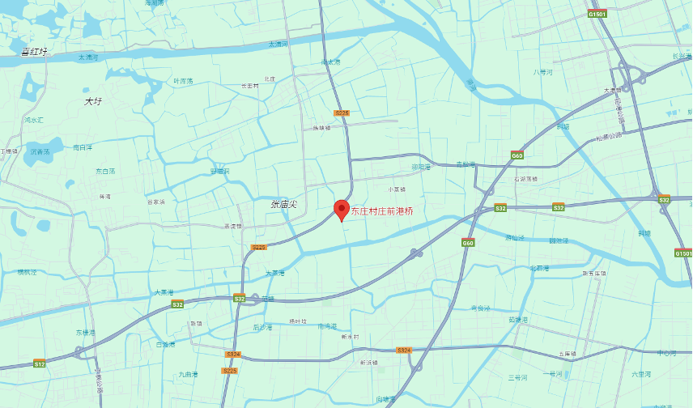
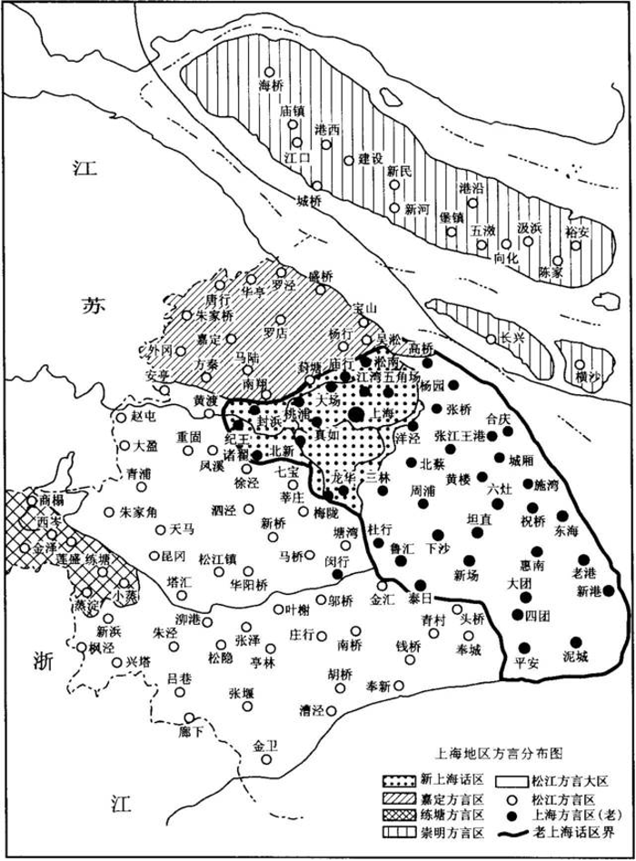
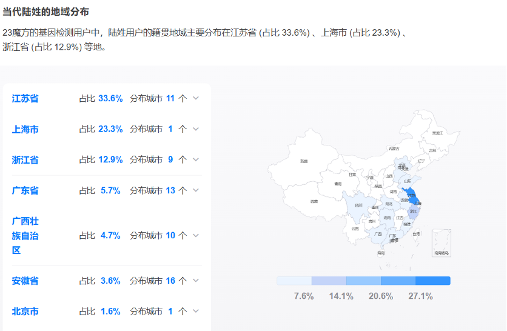
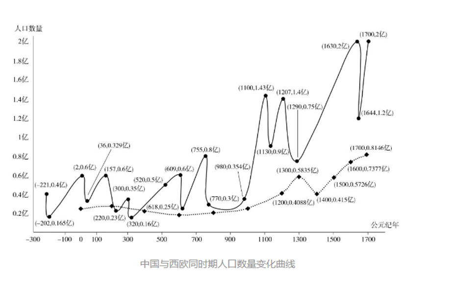
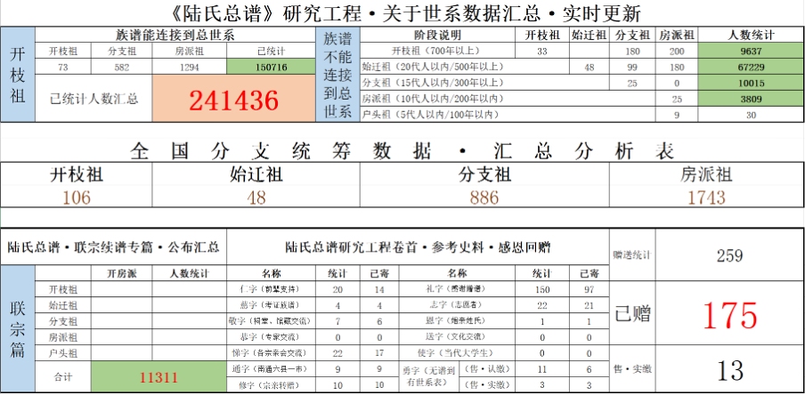
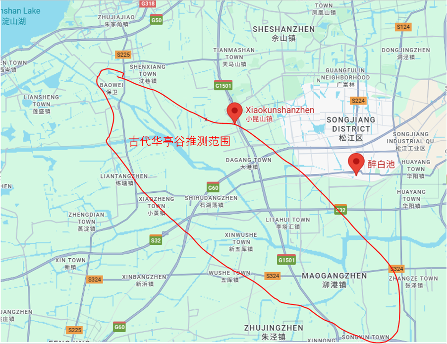
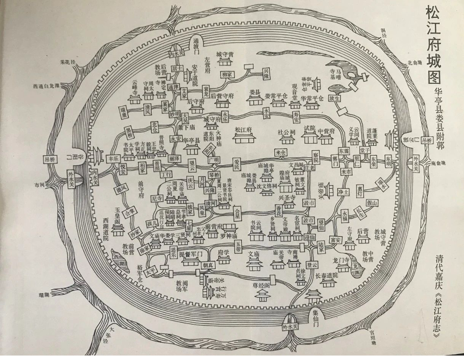
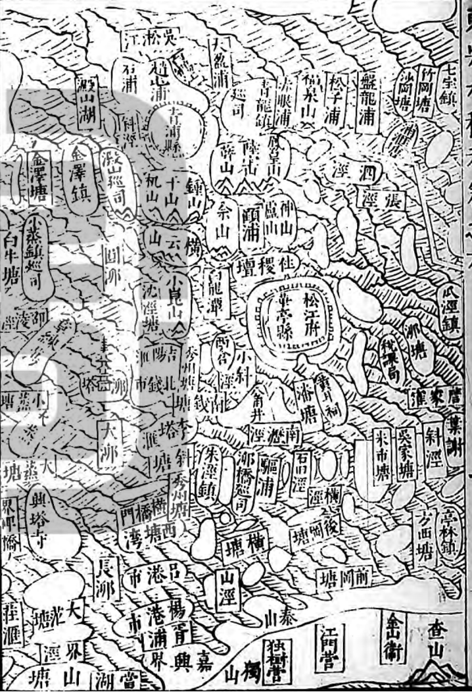

# 【读者来笺】陆竞烈｜青浦小蒸庄前港陆氏小考

- **来源**：人文中國 Humanities China Academy ([Substack 原文](https://humanitieschina.substack.com/p/fd8))
- **发布日期**：2025-10-02

---

编者按：在中国人的精神世界里，家族血缘不仅仅是血脉的延续，更是个人身份与文化归属的重要根基。身在美国的这位读者，以科学研究者的严谨和历史爱好者的热情，投身于陆氏家族的谱牒考证。这样的努力，不只是追溯先人的行迹，更是在当下寻找自身坐标的一种方式。我们愿将他的探索呈现给读者，赞许这份执着，也希望由此引发更多人对家族与精神传统的思考。若您曾参与过族谱修订有意交流，或本身即为蒸里陆氏的后裔，欢迎通过 humanitieschina@gmail.com 联系。

### 自序

去年我父亲来美探亲，带来了这本由我祖父陆鹤雄与伯伯陆富根编撰的《小蒸庄前港陆氏家谱》。书中以族中长辈的回忆为主线，解答了我自小以来关于家族来源的许多疑惑。然而，自庄前港陆氏第三代起，先祖姓名便已不可考，定居庄前港之前的历史更显扑朔迷离。作为从事生物科学研究十五年的学者，同时对历史考古颇有兴趣，我不禁跃跃欲试，想从地方志和统计资料中寻找蛛丝马迹。

陆姓为江南大族，唐以前的族谱脉络多有清晰记录。但宋元明清至近代，中国人口激增，而战乱、苛政及文献遗失，加之现代城市建设与老人凋零，使得理清家族脉络变得愈发困难。幸而人工智能时代的到来，使大量古代文献和笔记在互联网上得以文字化、公开化，这才让我有机会开展这一考证工作。

本次考证重点集中在元末明初蒸里的陆氏家族。尽管信息有限，但仍发现不少有趣之处。若读者有兴趣，我特别推荐进一步阅读曹知白及其朋友圈相关史料，这一领域在书画考证上颇有学术价值。我们可以借此窥见元代较为自由的社会环境，以及科学与艺术创作的开放氛围，这与传统直觉中的“元代破乱”印象大不相同。尤其以曹园雅集为核心的小蒸风雅往事，亦是后世子孙值得骄傲的文化遗产。蒸里各姓氏家族世代为邻、相互通婚，我们每个人身上都流淌着他们的血液。

在进行这些考证工作的过程中，经常有人问我，为何花时间在这些看似“无用”的故纸堆里？从生物学角度看，每个人的基因中都承载着历代祖先的DNA片段。而在大脑中，是否也存在着先人的某些影响？我想是有的。祖父年少流落沪上，土改时便渴望回乡务农，因身体原因转而报考农校；父亲终身从事农业科学；而我亦与农业科学结下不解之缘。曾困惑祖父为何对回乡种地如此执着，但读到陆泳的《田家五行》之后，似乎找到了答案。

---

对于庄前港村陆氏始迁祖及二代祖的考证，虽然直接的文献资料不足，但通过长辈的口述回忆以及新编家谱的记录，我们可以对祖先的迁移背景和生活状态做出一定的推断和理解。始迁祖从所谓的“河西”地区迁移到庄前港，但“河西”具体指哪里，以及为何陆氏家族会从那里迁移过来，目前难以确切了解。自1949年以来，由于历次政治运动，家庙祠堂被毁，谱书流落遗失，使得族谱的修订和祖先来源的考证变得更加困难。尽管如此，通过新编族谱中的一些细节，结合现存的乡志以及其他史料，我们可以对陆氏家族的迁移路径和生活背景做出一些推断：

#### **1. 蒸里地区概况与河西探究**

根据地图信息，庄前港位于小蒸镇与蒸淀镇之间，周边有泖河、太埔河、园泄泾以及俞汇塘等大型河道。根据清光绪年间叶世雄所著的《蒸里志略》的描述，明清时期的蒸里地区基本囊括现代小蒸镇和蒸淀镇行政区，蒸淀镇对应明清的大蒸地区，而庄前港亦居于大小蒸中间，因为此在检索古代现代文献资料需特别注意大小蒸地区的行政变化。蒸里地区处于泖河与园泄泾交汇入黄浦讲的三角地区，园泄泾与上游大蒸塘为一条河的不同河段，家谱所提供的《1958年以前庄前港的平面布置图》所示，村子南部为黄浦江，应是误将大蒸塘称为黄浦，亦或民间未必区分二者，认为大蒸塘即黄浦江上游。根据2006编纂《小蒸志》对于庄圩村的描述，庄前港分为河东河西两部分，因而河东陆氏由河西迁入，可能意味着陆氏先祖为世居蒸里地区。

#### **2. 庄前港陆氏迁居时间点探究**

庄前港陆氏家族的迁移历史，依据家谱记录，可以通过第三代先祖陆修方的生辰（1847年，清道光二十七年）来追溯，这个时间节点位于太平天国运动（1850-1864年）爆发之前，为我们提供了关于家族迁移时间的重要线索。太平天国运动作为咸丰年间在江南地区爆发的重大兵灾，对当地社会经济造成了极大的冲击，尤其是人口结构，苏州府的人口损失高达近65%。而松江府，由于属于上海租界洋枪队（常胜军）的战力范围内，因而不是太平军与湘军的主战场，人口损失相对较小，仅约10%。据《蒸里志略》所载，太平军于咸丰十年润三月犯境松江亦劫掠小蒸地区，同年九月为华尔洋枪队所破，从此“不敢复窥松江”。大平天国在江南产生大规人口模灾难导致江南府县出现了大规模荒地出现，例如湖州，南京，镇江地区在太平天国之后出现了大规模江北甚至湖北人口的迁入现象。杭州城内亦迎来了大规模的绍兴移民，俗称“杭州萝卜绍兴种”。更加显著的例子为大量江南难民涌入上海租界，导致了上海人口的几何倍增长。这种巨量人口迁徙往往导致对族谱探究难度增加，所幸蒸里地区所受影响有限，且陆氏定居庄前港河东远早于太平天国之祸，一般来说古代和平时期长距离人口流动相对不活跃，因而河东陆氏由周边临近地区迁入的概率较高。

#### **3. 庄前港陆氏迁居原因探究**

庄前港陆氏家族定居河东的具体原因可能已难以确切知晓，但根据明清蒸里地区的地理变化可以推敲一二。根据2006编纂的《蒸淀志》与《小蒸志》描述，蒸里地区土壤属于“低洼荡地”与“低洼泖地”，这一类土地一般都是新晋成陆的土地，在水位上涨时期还有被淹没的可能。明清时期从太湖到淀山湖到黄浦江地区，这一类的新形成的土地十分普遍，因为长江从上游所带来的泥沙亦会逐渐在这个区域沉淀，导致湖泊缩小，出现新的耕地。这种现象亦可在苏松地区的地名中可以看出，汉字“塘”，意为圆形湖泊，而如今大蒸塘实际为一条河浜，这种描述和现实不一致或许反应了这种地理上的变化（或也因此上游大蒸塘和下游园泄泾没有被描述为同一条河）。另外根据《蒸里志略》，泖河古称圆泖，实际为一个圆形的大湖，一直衍生到接近松江府城（合称长谷）。这种新陆地和耕地在历史上逐渐的形成，应该持续推动蒸里地区人口流动的重要推力。根据对本村的平面布置图的描绘，村临近大蒸塘（黄浦），因而极有可能是此类新形成的陆地。另外小规模的天灾、匪患也在《蒸里志略》中多有记录，这些小规模灾祸亦可能产生一些家族绝户等因素有关，因而导致了一些荒地的出现和出售，为陆氏家族提供了迁移和定居的机会。

古代人口迁徙的模式确实与地理和文化因素紧密相关，特别是在社会稳定的时期，人们倾向于迁移到交通便利且文化相近的地区。这种迁移促进了人口的双向流动，如婚娶、亲友投奔、工作介绍等，从而在一定区域内形成了方言和文化习俗相似的单元。上海地区的方言分布情况反映了这一点。小蒸、蒸淀、练塘、莲盛、金泽、商榻和西岑等地属于练塘方言区，这一区域由泖河、太埔河和园泄泾所围成的地理位置形成了一个独特的文化和方言圈。这一方言区与松江方言区相比，更接近吴江方言。根据族谱所记，余曾祖陆元森的营造厂最初在小蒸与练塘之间发展，并最终举家定居于练塘镇，也应该是收这种相近文化带来的工作生活便利所影响。

#### **4. 江南地区陆氏共祖-东吴选曹尚书陆瑁**

籍贯江南的陆氏主要来源为中国中古时期以吴郡为郡望的陆姓家族，与吴郡顾氏、吴郡朱氏、吴郡张氏并称“江南四姓”。明朝时期，陆姓人口增至约52万，占全国人口的0.56%，浙江是陆姓人口最多的省份，占陆姓总人口的50%。明朝时期，陆姓的主要分布区域依然是浙江和江苏，这两省的陆姓人口占全国陆姓总人口的84%。当代，根据23魔方的基因检测用户数据，陆姓用户的籍贯地域主要分布在江苏省（占比33.6%）、上海市（占比23.3%）、浙江省（占比12.9%）等地。这一数据与历史上陆姓在江浙一带的集中分布相呼应，皆可追溯到历史上赫赫有名的吴郡陆氏家族。

吴郡陆氏始祖为齐宣王的少子陆通，封平原县，得姓陆。到了汉初，陆烈始迁至吴地。汉颍川太守陆闳立颍川支，为最早成雏形的大家族。三国时期，吴郡陆氏族人中崛起了东吴丞相陆逊、及其兄弟选曹尚书陆瑁，使得陆氏进一步成为了江南巨族。陆逊之孙陆机、陆云兄弟（合称二陆），于晋朝更是名扬天下。有唐一朝入相的吴郡陆氏成员有六位, 是吴中四姓中最多的一家，分别为丹徒枝陆敦信、太尉枝陆元方、陆象先、陆希聲、侍郎枝陆贄、陆扆。陆氏在白马驿之祸时遭受直接打击，唐亡后，开始以苏松地区为中心向周边各地迁徙，进一步分化为四十九枝（详见附录《元陆式修谱格式世系表挂线图之陆氏总谱49支总目》）。

中国古代人口数量总结来说有两个特点：一个是人口数量整体呈增长态势，且在大部分时间都高于其他国家和地区；另一个就是中国人口数量大起大落，变化剧烈。这种大起大落的人口变化可以归因于王朝覆灭所造成的战乱，引起来人口雪崩。在这种时代很多不够繁盛的家族会出现绝户，而生存下来的家族会在接下来的太平时代再次出现人口井喷。因此许多历史上的陆姓名人由于政治与战争皆未能留下后代。其中最著名的例子为三国东吴丞相陆逊（官封华亭侯，封地即现今淞沪地区），以“夷陵之战”击败汉昭烈帝刘备而名扬天下。其孙陆机陆云为西晋重臣，合称二陆，为当世文学之巨匠。然而陆机于“八王之乱”兵败于司马颖，遭夷三族之祸，以致陆逊子孙于后世凋零殆尽，为我吴郡陆氏一场极大浩劫。而然陆逊之弟东吴选曹尚书陆瑁，虽知名度不如其兄，但其后人留守祖地松江，未卷入这场兵灾，反而保全陆氏家族，成为现代江南陆氏共祖。根据微信公众号《陆氏总谱》主编人维扬陆氏所提供的统计资料，其团队所收集的所有陆氏族谱无一不把始祖指向陆瑁。

#### **5. 蒸里地区与吴郡陆氏起源地**

江南陆氏以吴郡为郡望，家族兴旺于三国陆逊与陆瑁兄弟。关于两兄弟的出生地，史料存在争议，这主要由于古代吴郡辖地广阔，相当于现代的苏南、浙北及上海的大部分地区（《三国志·吴书·陆逊传》）。据考证，陆逊字伯言，其生地位于吴郡境内，但具体方位难以精准界定。陆逊受封华亭侯后，其家族逐渐在华亭地区扎根并繁衍。其孙辈陆机、陆云成为西晋时期著名文人，世称“二陆”，并被后世推崇为松江人文鼻祖。二陆在太康十年（289年）迁往洛阳，以文才闻名，受到太常张华赏识，时人有“二陆入洛，三张减价”之说。

关于二陆的居所，《松江县志》记载：“二陆宅在昆山下，为陆机、陆云故宅。陆机诗云‘仿佛谷水阳，婉娈昆山阴’，即宅所在方位。”据考证，此处“昆山”并非今江苏昆山，而为现今上海松江区的小昆山，现存“二陆读书台”“二陆草堂”等古迹。此外，《至元嘉禾志》记载陆逊之弟陆瑁的居所位于松江府城西侧的瑁湖，“瑁湖在县西北三十五里，周回九里，吴尚书陆瑁养鱼池，因以为名。”瑁湖因潮汐泥沙淤积逐渐缩小，并于清代消失，其周边遗迹融入现今的醉白池。

虽然大小蒸地区今属青浦，但从历史与地理联系来看，其与松江府城关系更为密切。松江古名华亭，原属云间，因陆逊封侯建宅而更名华亭。该地因谷水环绕，故亦称华亭谷。唐代李吉甫《元和郡县志》卷二十六记载：“华亭谷，在县西三十五里，陆逊、陆抗宅在其侧。”据此，华亭谷应为现代泖河前身，是一片巨型椭圆形湖泊。汉代华亭谷规模更大，其东侧水域延伸至小昆山一带。北宋王安石在其诗作《华亭谷》中称其为“巨川”，可见宋代其规模依旧宏大。随着湖泊沉降及泥沙淤积，泖河两岸及西侧练塘地区逐渐形成陆地。据《东吴水利考》绘制图示，明代圆泖与长泖仍然庞大，大小蒸与小昆山相对而望。

综合史料与地理考证可见，吴郡陆氏发祥的核心区域位于松江府城西侧至古代华亭谷一带。蒸里地区与此仅隔一河，其庄前港陆氏应源自陆逊陆瑁为代表的吴郡陆氏，可视为淞沪地区乃至整个江南的世居土著家族。

***选自明代《东吴水利考》***

#### **6. 江南陆氏的唐代共祖**

蒸里陆氏虽与二陆宅相距不远，但这并不意味着我族自汉代以来从未经历迁徙。正如前文所述，历代频繁的战乱引发了大规模人口流动，从而造成新的迁徙格局。根据《陆氏总谱》提供的族谱信息统计（入谱人数共计241,436人），现存的陆氏族谱大体都可追溯至唐代的几位共祖。其中：

· 入谱人数最多的共祖为**陆宣公**（陆贽，唐德宗朝翰林学士、宰相，谥号“宣”，传世《翰苑集》），其后裔占总入谱人数的 **46.5%**；

· 第二位为**陆高士**（陆龟蒙，字鲁望，自号江湖散人、甫里先生，又号天随子，唐代著名诗人、隐士），其后裔占 **11.9%**；

· 第三位为**陆希声**（号鸿磬，自号君阳遁叟，又称君阳道人，昭宗年间曾短暂拜为宰相），其后裔占 **2.5%**。

三人合计已占全部入谱人数的约 **60%**。其余则多为谱系未详或长三角以外的陆姓（如广西陆姓中大量源自少数民族改姓，与吴郡陆氏无涉）。因此，蒸里陆氏极可能亦源出这三大支系之一。

唐代初创科举制度，至宋代趋于完备；而在宋以前，中国仍是严格的士族社会，因此唐代名人往往有明确的门第记载。陆龟蒙与陆希声分别为武周宰相陆元方七世孙与五世孙，出自吴郡陆氏**太尉支**（始祖为东晋司空**陆玩**，字士瑶，卒后追赠太尉，详见附录《亨陆式修谱格式世系表挂线图之陆氏太尉支直下四十二世》）。而入谱人数最多的陆贽，则为吴郡陆氏**侍郎支**（源自东晋中书侍郎**陆瓘**，陆玩之弟，详见附录《元陆式修谱格式世系表挂线图之陆氏总谱49支总目》）。史料可见，陆贽居嘉兴，陆龟蒙居苏州甫里（今甪直古镇），陆希声晚年迁居宜兴，反映了先祖在太湖流域一带的迁徙轨迹。

若不考虑上海市区陆姓的来源（因近代移民频繁，难以厘清），从各类陆氏族谱来看，上海郊区，尤其松江、浦东一带的陆姓以高士支（陆龟蒙后裔）为主（见附录《开支祖情况摸底》）。这是因为陆龟蒙的后人迁居松江府城，形成“云间陆氏”家族。该支自宋元明以来人才辈出，世有显宦，族势兴盛。史载，陆龟蒙第五十二世孙**陆霆龙**于南宋咸亨年间登乡贡进士，时已定居松江府城。其子**陆居仁**（字宅之，号巢松翁），隐居不仕，工草书，与杨维桢、钱惟善唱和，被誉为“元末三高士”。

陆霆龙之孙**陆坚**，过继于温州平阳黄氏，改姓黄，名公望（字子久，号一峰、大痴道人），即元代大画家**黄公望**，其《富春山居图》堪称中国古代水墨山水画之巅峰，被誉为“长卷第一神品”。陆霆龙另一孙**陆德衡**与其子**陆行之**则迁居上海洋泾，成为上海县望族。陆行之之孙**陆深**（初名荣，字子渊，号俨山）尤为著名：明弘治辛酉解元、乙丑进士，累官詹事府詹事。今“浦东陆家嘴”即因其旧宅而得名（其墓位于现今海兴路西、东宁路北一带，1969年浦东修建人防工程时被毁，随葬文物现藏上海博物馆）。浦东地区因长江泥沙沉积逐渐成陆，陆深家族因而占得先机，在浦东开枝散叶，形成川沙塘桥四大支派（见附录《开支祖情况摸底》）。此外，陆行之后人亦有迁居青浦朱家角（古称珠溪），形成“云间珠溪支”。其代表人物为清末民初的名医、小说家**陆士谔**（名守先，字云翔，号士谔，别号云间龙、沁梅子等）。

查蒸里地区地方志可知，元代时陆氏已于此地深耕不辍，曾有隐士**陆泳**（详见下文）。他与陆居仁、黄公望均有交往。这或许也增加了蒸里陆氏与云间陆氏同出高士支的可能性。

#### **7. 蒸里地区陆氏人口自元明清至现代的变迁**

庄前港陆氏有生辰记载的最早祖先为第三代先人陆修先，生于1847年。若以每代相隔20–25年推算，其第一代定居先祖虽已无名号可考，但大致可推定在约1800年前后（清嘉庆年间）迁入庄前港。另据族中长辈回忆，先人由庄前港河西迁至河东，若假设先人定居河西逾百年，则可以将庄前港陆氏家族定居河西历史至少推断至清初。

根据《蒸淀志》（2004）与《小蒸志》（2006）所引2000年人口普查数据，蒸淀镇陆姓人口1715人，位列第二；小蒸镇陆姓1282人，位居第一，两地合计2997人。另据《蒸里志略》《松江府志》等方志，蒸里地区在元末与明末均未出现大规模人口崩溃（如嘉定三屠、扬州十日等惨剧）。由此推论，庄前港陆氏很可能为元明时期即已定居于此的世居族群。

《清代人口史》估算，自清初至2000年，中国人口总体增长约8–10倍。依此推算，清初蒸里地区陆姓人口约为300–374人。若再上溯至元末明初，则该地区陆姓人口或仅在5人左右（元代全国人口约2千万，至2000年增加约650倍）。在排除区域人口增长差异及偶发天灾人祸的情况下，这些估算提供了一个大致的人口规模参照。基于此，我们下一步的研究将尝试结合蒸里地区相关史料，考察是否存在与此规模相符的陆氏群体，从而在缺乏系统族谱的前提下，探索其可能的祖先人物及生活轨迹。此推断亦建立在一个前提假设之上：即蒸里陆姓人口在相当程度上来源于同一陆氏家族。

#### **8. 元末明初蒸里地区陆泳家族探究**

地方史料中确实可以见到元末明初活跃于蒸里地区的陆泳家族，其代表人物为元末著名隐士陆泳（字伯翔，居大蒸）。《蒸里志略》载其故居在大蒸陆家宅，距大蒸西一里处，清代尚存遗迹“钓湾”，相传为陆泳垂钓之所。《松江府志》亦称陆泳博览群书，隐居不仕，却专心于农事研究，兼采方言与乡俗，著有《田家五行》（现存最早版本为明嘉靖九年顾应祥刻本），杨维桢、陆居仁曾为之作序而传世。虽二人所作序文已不可考，但《松江府志》尚保存钱惟善为之作序，其称赞曰：

> 
> “天时尝徧考历代诸氏之说，以为一家之书。其占风雨，视氛祲，地利有高下之宜，天道有旱潦之分，罔不傋具，而所以朝占暮观者，用心亦良苦矣。”

如前所述，陆泳、杨维桢、钱惟善并称“元末三高士”，皆居松江地区，时为一代名流。至于蒸里陆泳家族与居住松江府城的陆居仁家族是否为亲族，尚无定论。若未来能发现陆居仁所撰序文，或可进一步探究其中关系。

值得注意的是，《田家五行》不仅记载了太湖流域农事与气象经验，同时也透露出不少陆泳家族情况：

> 
> **其一：**
> 《田家五行》有言：“近至正丁亥正二月，遍传溪边淅米，浑泔中结成小鱼儿游洋，去远方散，谓必有水。”句中“近至正丁亥”表明全书成于至正丁亥（1347年，元顺帝时）。
> **其二：**
> 书中云：“尝闻余大父言，昔中年一元旦，曾于庭前沟口，独见一鼠对面拱立……大父晚年，子孙蕃衍，家事从容，至老康健，寿享八十九岁。”此处不仅提及陆泳大父（即祖父）高寿八十九岁，亦说明其家族在当时子孙繁盛，规模已具。若以1347年上推五至七十年，则可推测陆氏至少在南宋末年已定居大蒸。
> **其三：**
> 书中又言：“余家所种低田数多，正苦于插种过时，田中积水，车峻未有干期，此日尚且勉强督工。”此语说明陆氏家族田亩广布，需雇工督作，显然为当地颇具规模之乡绅地主 （（亦与《蒸淀志》与《小蒸志》中记载的“低洼荡地”与“低洼泖地”呼应））。
> **其四：**
> 书中另云：“予自有生以来，幼时祖父及自主祭此是。”表明其自幼随祖父行祭祖之礼，继而自任家族祭祀主持，可见其在宗族中地位重要。
> 除《田家五行》外，其他文献亦为我们提供了陆泳更多信息。《玩斋录》所收《贞素先生墓志铭》记载，元代巨富、画家兼藏书家曹知白（字又玄，号云西，人称贞素先生）有五位女儿，其中一女适同里陆泳。
> “女五人：长适上海瞿天祐，早卒，继室以季女；次适嘉定高巴延；次适常德路达噜噶齐哈喇哈达，封大兴县君；次适同里陆泳。”

由此可知，陆泳系曹知白女婿。曹知白之外孙邵亨贞（字复孺，号贞溪，文学家与诗人）在《农田余话》中亦称“故眷家伯翔陆先生尝著《田家五行志》若干卷，专述田家俗谈，为农家占候之书，率多可验。”。又于《蚁术诗选·编校遂生亭联句并序》中提及“诸父钱南金、陆伯翔、陆伯弘皆外姻也。”足证陆泳与曹知白、邵亨贞之姻亲关系。

曹知白是元代江南文人画的核心人物之一，不仅富甲一方，且艺术造诣极高，还在土木工程方面有所建树。至元三十一年（1294）开凿吴淞江的工程中，他功绩卓著。其山水画风承继宋代李成、郭熙的传统，又融汇董源、巨然等南派流脉，形成自家风格。存世作品有《清凉晚翠图》《群山雪霁图》《疏林亭子图》《双松图》《松林平远》等。元末天下动荡，唯松江一隅兵火较轻，“九峰三泖”胜景更添诗意，遂成为文人寄迹之桃花源。明代文徵明亦曾云：“松江在元季时，鸿儒硕彦多避地于此。”当时，曹知白在小蒸自宅“曹园”每期举办“曹园雅集”，诗酒唱和，笔墨争胜，盛极一时。赵孟頫（其晚年亦寓居大蒸，清代尚存“松雪读书亭”遗址，其妻管道昇更是小蒸才女）、邓文原、虞集、王冕、倪瓒、黄公望等名流，皆为常客。蒸里一度成为文化高地，与昆山顾瑛所办“玉山雅集”并峙。《蒸里志略》载，曹园园池凡八十余所，广袤数里，其规模不逊《红楼梦》中的大观园。陆泳能与曹氏结亲，足证其家族殷实、门第显赫。

曹知白与黄公望尤为交好，后者久留曹园，相传《富春山居图》即在此地完成。黄氏绘事往往需数年，常携画卷与友人游处、切磋，曹园正是其孕育大作之地。黄公望亦为曹知白之子曹世长绘《溪山雨意图》题跋，并为曹知白外孙邵亨贞绘《富春大岭图》，题曰“大痴为复孺画”（“大痴”为黄之别号，邵字“复孺”）。推想陆泳及其子弟亦当常出入曹园雅集，与黄公望相交不浅。况黄公望本出自松江陆氏，为陆居仁侄儿，则黄曹友情是否又因曹陆姻亲而更为笃厚，实耐人寻味。

邵亨贞，字复孺，号贞溪，其祖母为曹知白之妹。幼时随曹知白寓居小蒸，长大后更为“曹园雅集”的常客，时与诸名士登临赋咏、游山玩水。其所著有《蚁术词选》《蚁术诗选》《蛾术集》《野处集》等词文集，流传至今。这些作品中保存了大量与松江地区文人唱和的诗篇，对了解蒸里文脉与陆泳家族，提供了珍贵史料。

> 
> **其一：**  
《蚁术诗选》中《编校遂生亭联句》序云：后至元二年岁丙子十一月（1336），曹知白在曹园遂生亭与其子曹世长、堂弟僧自闻熏师，以及后辈邵亨贞、陆伯翔、陆伯弘、钱南金等八人同聚，设宴联句。序文又曰：“后此卅余年，诸老相继沦没，存者惟伯翔及予，亦皆年逾耳顺，乘白昏耄。”落款为“庚戌年”，即明洪武十三年（1374）。由此可知，遂生亭雅集发生于1336年冬，而序作于三十八年后。当时陆伯翔、邵亨贞年皆逾六旬，则可推陆泳约生于1306年前后。若再推其上两代，则陆氏祖父约于南宋中后期已定居蒸里。又依时间推算，陆泳大约在四十岁时完成农学名著《田家五行》。
> 文中亦感叹元末战乱对蒸里的破坏：“中经干戈屡变，世道衰微，二翁故居悉荡为丘陇，求其遗迹，亦复苍莽。”曹园壮丽不复，邵亨贞悲叹：“物换人非，斯文扫地，后之人非特不能继前修风度，亦将不能知而言之矣，可胜叹哉！”此处读来令人动容，正是“盛筵难再，风流散尽”的沧桑。
> **其二：**  
《蚁术诗选》中《送陆伯翔翁往金陵授业侯门》又记载，明初天下统一后，陆泳受聘于南京某侯府讲学授业（诗中称“列鼎宫壶衮绣家”），与《松江府志》所载“博览群书”相互印证。诗云：“凤凰台上春风起，鹦鹉洲边暮景斜。四海车书今复混，六朝文物尚堪嗟。深衣雪鬓弦歌老，列鼎宫壶衮绣家。回首故园如隔世，身閒不必问生涯。”.
> 另有《早春次陆伯弘韵》《熏自闻上人禅房与陆伯弘暮坐偶成》《新春答陆伯蒙见寄之韵》三篇，皆提及陆伯弘、陆伯蒙。邵亨贞自注“陆伯翔、陆伯弘皆外姻也”。三人皆以“伯”字为字辈，显系同族兄弟或堂亲，且俱擅诗文，可见蒸里陆氏已是一个具有相当规模与文化底蕴的家族。
> **其三：**  
明人朱存理《赵氏铁纲珊瑚》录有《贞溪诸名胜词翰》，其中两首乃邵亨贞应和钱惟善（字思复，即“元末三高士”之一）为陆泳祝寿所作。
> **诗一曰：**  
“曲江先生录示元夕所寿伯翔翁之作，且征鄙和，是以赏音见许也……亨贞再拜。  
青袍朝士识贞元，时论前修教子孙。彩笔自堪修五凤，黄金谁复购长门。雨深灯火杯频举，梦入池塘草渐繁。兵后吴山春尚好，莺花应满旧家园。”
> **诗二曰：**  
“追次前韵，遥致翔翁亲长弥高之颂。亨贞端拜。
> 晋代经今屡改元，云间二陆尚诸孙。承平不改丘园隐，为庶仍推德泽门。祖砚传家终遗远，农书成帙更芟繁。”
> 诗序可知，钱惟善为陆泳寿辰作诗，邵亨贞继和，足见三人关系之笃。邵亨贞生于1309年，称陆泳为“亲长”，则当时陆泳确年长数岁，与前文推算陆泳生年相符。诗中赞陆泳“时论前修教子孙”，隐示其家族兴盛；又谓其为“云间二陆”之后（即陆机、陆云），或属赞美之辞，因迄今未见追溯至“二陆”的族谱佐证。最后句“祖砚传家终遗远，农书成帙更芟繁”，则分明称颂陆泳以诗书为世业，尤以《田家五行》垂泽后人，成为家学与地方文脉的重要象征。

总结以上资料可见，元末明初之际，蒸里陆氏家族已颇具规模。陆泳之祖父以及陆泳本人皆子嗣繁盛，加之同族兄弟或有记载、或已佚失，足见家族基底雄厚。假设明初蒸里陆氏有可生育男性约二十人，若至2000年人口规模达2997人，中间六百年计二十代，则平均每代仅需生育并存活约1.285名男性即可。考虑明清之际人口激增，此种增长幅度实为极高概率之事。尤值一提者，在史料所见人物中，陆泳祖父寿至八十九岁，曹知白八十三岁，邵亨贞九十三岁，陆泳卒年虽未详，然邵亨贞以“弥高”称之，似亦寿考。此数位蒸里先贤，既互有姻亲，又多享高寿。我祖父常言我陆氏一门自有长寿基因，彼今亦九十三岁，族中长寿者亦不乏其人。或可推想，这一遗传特质，或与蒸里诸先人的血脉绵延相关。

这些零散的史料、家谱片段与地方志记载，未必能还原一条完整的脉络，却拼凑出陆氏家族在江南土地上的生息与迁徙。考证的过程本身，也让我看到历史的多重面貌：一方面，是具体家族的血脉延展；另一方面，则是江南社会在地理变迁、战乱与文化交汇中的缩影。许多细节仍待补足，但正因如此，研究才有继续展开的价值。未来若能发现新的谱牒或文献，相信这一幅未竟的图景，还会渐渐清晰。
